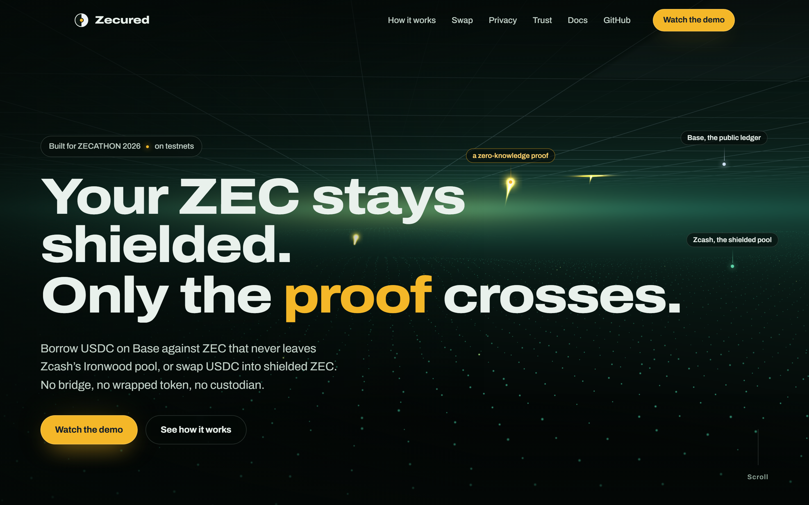
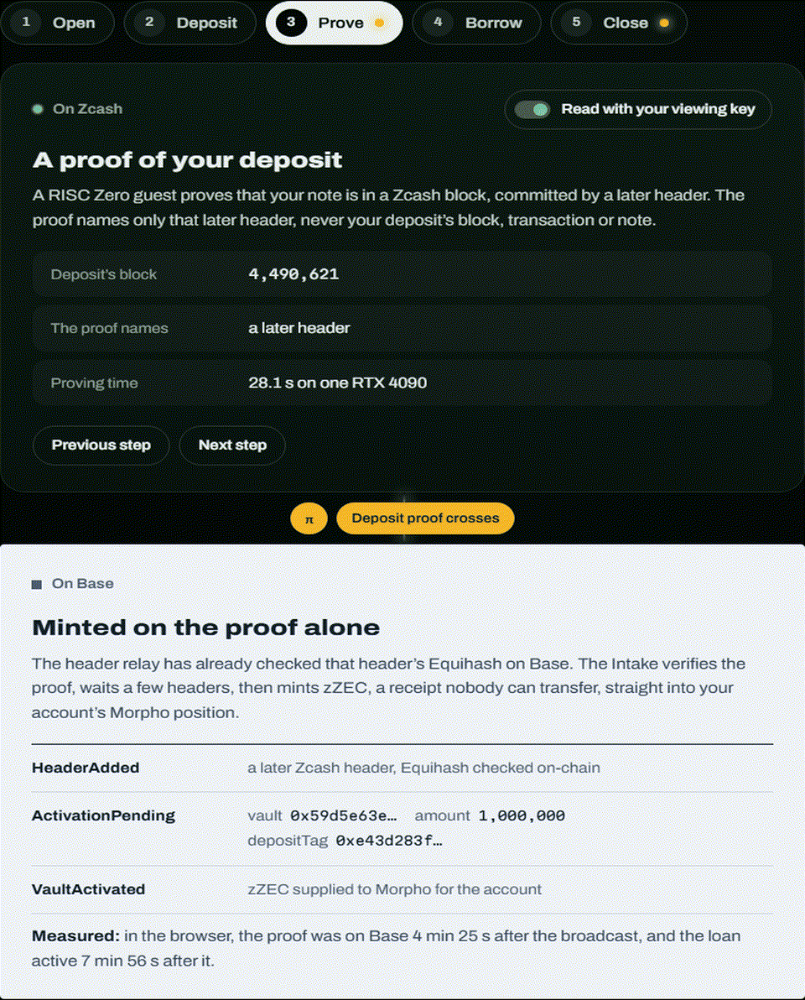
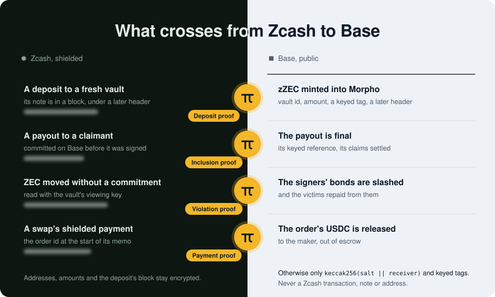

# Zecured



> **Use shielded ZEC on Base: borrow against it, or swap into it. It never leaves the shielded pool.**

See [the site](https://himess.github.io/zecured/), [the demo video](https://himess.github.io/zecured/#demo) or [how to run it on a local fork](#local-base-fork).

Using ZEC in DeFi today usually means taking it out of the shielded pool. Zecured doesn't.

Two products, one Zcash light client on Base:

- **Borrow.** Borrow USDC on Base against ZEC that stays in Zcash's shielded Ironwood pool. The ZEC
  sits in a fresh **3-of-5 FROST threshold vault**; on a zero-knowledge proof of the deposit, a
  **non-transferable collateral receipt (zZEC)** is minted straight into a **Morpho Blue** position of
  a fresh, gasless smart account. Close by repaying in USDC, or **close from collateral**: a market
  maker repays the debt and takes ZEC for it, and the rest returns to a new shielded address, so no
  outside funds ever touch your account. A liquidation, or a pre-liquidation the borrower opted into,
  pays in shielded ZEC too.
- **Swap.** Swap USDC into shielded ZEC with no custodian, no signer and no wrapped ZEC. The USDC
  waits in escrow on Base and is released by a zero-knowledge proof, made by whoever paid, that a
  shielded payment for that very order is in the Zcash chain. Any Ironwood address can receive.
  Selling ZEC for USDC works the same way, from the CLI ([docs/SWAP.md](docs/SWAP.md)).



The shared core is a Zcash light client on Base: `ZcashHeaderRelay` verifies Zcash headers
(Equihash) on-chain, ZIP 221 history commitments keep a proven block hidden among its epoch's, RISC
Zero guests prove deposits, payments, payouts and violations, and `ZecuredVersions` lists the
verifiers each proof is checked with.



**Who you have to trust.** Base never takes the signers' word: deposits are proven, payouts are
proven, misbehaviour is proven — and the same Zcash light client lets anyone swap USDC into shielded
ZEC with no custodian.

- **Deposits.** Every deposit of a vault's amount is brought onto Base by a zero-knowledge proof that
  the note is in a Zcash block whose header Base verified, as collateral or as a refund
  ([Tier 2](docs/TIER2.md)). Minting needs no signer, except that all five together can schedule a
  new verifier version, which takes effect only after a public delay. New collateral is accepted
  only while the bonds cover its value.
- **Payouts.** Signers must commit every payout on Base before they can sign it, and a payout is
  final on Base only once its inclusion in a Zcash block is proven in zero knowledge; the coordinator
  proves every payout, and anyone can. A signed confirmation is a fast first step that its claimant
  can dispute.
- **Misbehaviour.** Taking ZEC that backs loans (without a commitment, or under a false one), or
  paying any claim to anyone but its owner, is provable on Base with a zero-knowledge proof that
  reveals no Zcash transaction, note or address, and it slashes the signers' bonds
  ([Tier 3](docs/TIER3.md)); the bonds compensate the victims: liquidators and lenders before the
  borrower's own equity.
- **Liveness.** Once a signer has acknowledged a claim's destination, a claim left unpaid for 24
  hours (72 on mainnet) is paid to its claimant from the bonds. Three of five signers can pause new
  minting for up to 30 days at a time; withdrawals, repayments, liquidations and payouts never stop.
- **Swap.** No signer and no bond take part in a trade: its USDC moves only on a payment proof,
  checked against the relay with the same work and readiness rules as a deposit. A market maker that
  never pays costs its taker only time.

What the bonds cover and what they do not: [docs/ECONOMICS.md](docs/ECONOMICS.md).

On Zcash testnet a single Equihash ASIC out-mines the whole network about 40 times over, so every
proof-of-work-based guarantee here — Tier 2 minting and Tier 3 slashing — is demonstrative on
testnet. On mainnet the same mechanisms inherit Zcash's proof of work, with confirmation depth
chosen by the value at risk. The five demo signers are run by the team; the bonds demonstrate the
mechanism, not independent economic security.

Built for ZECATHON 2026, Cross-Chain track. **Testnet experiment — not a financial product.**

## What works today

Verified end to end on **Zcash testnet (NU7)** with five independent signer processes:

| Flow | Result |
|---|---|
| Vault creation | 5-party FROST DKG over HTTP (node-to-node encrypted), ZIP 2005 `use_qsk` keys, Ironwood-only address |
| P1 deposit classification | Ironwood-only deposits of the exact denomination conform; a wrong amount is non-conforming |
| P5 refund | Owner-signed request, PCZT verified by each signer, 3-of-5 FROST signature, ZEC back in the wallet |
| P2 repay + release | zZEC burned on Base → payout to the borrower's new Ironwood address → `confirmPayout` |
| P6 close from collateral | Market maker repays on Morpho; market maker and borrower paid in **one** Zcash transaction |
| P3 liquidation | Bot liquidates after a price drop; liquidator paid with `ovk = None`; the remainder stays the borrower's and is released |
| Partial release (D14) | Part of the ZEC paid out while the loan stays open (LTV after ≤ 50 %), the rest released later |
| Failure handling | Payouts with two signers offline, a signer restarted mid-payout, and a payout that expired unmined and was rebuilt |
| Threshold demo | Two signers switched to "compromised" sign a sweep, three refuse, nothing moves |
| Vault verification | The borrower scans the vault with its viewing key (UFVK) |
| Tier 2 deposit proof | The deposit statement on a real deposit: the zkVM's journal equals the native one (20.2 M cycles), the relay verified the anchor header's Equihash on-chain |
| Tier 3 commit before sign | A real payout's `SpendCommit` signed by the three chosen signers in FROST round 1, recorded on Base, and checked by every signer three blocks deep before it released its share; then mined and confirmed |
| Tier 3 violation statements | F1 holds on a real Testnet vault spend and the slasher's tests slash with exactly that journal; F1 and F3 run in the zkVM with the native journal |
| Real seals of the pinned guests | Real Groth16 seals of deposit-test, violation-test (F1 and `Included`) and payment-test pass RISC Zero's router on Base Sepolia and Base mainnet forks; the STARKs take 4 to 37 s on an RTX 4090 |
| Proven delivery | A disputed confirmation made final by the payout's inclusion proof 2 min 51 s after the dispute; routine proofs inside the dispute window |
| Zecured Swap | Buy and Sell orders settled on payment proofs (payment memo `"ZSWP" ‖ orderId`, ovk none); an unpaid order refunded after its pay window |
| Theft demonstration | Three compromised signers sweep a vault; the borrower's viewing key detects F1 two minutes later; all five bonds slashed; the victim's debt repaid and the rest of its ZEC's value paid in USDC ([the timeline](docs/assets/theft.png)) |
| The app in a browser | Gasless: open, deposit, borrow with pre-liquidation terms, deleverage and close from collateral (Safe signatures), repay and release, a claim paid from the bonds |

The Base side has been run on local forks of Base Sepolia (the real Morpho Blue deployment and
RISC Zero router). No deployment is kept running through judging ([D82](docs/DECISIONS.md)):
the whole system runs on a local fork (below). Evidence (block heights, short txids, timings) and
how to reproduce every run: [docs/TESTING.md](docs/TESTING.md).

## What is real and what is a mock

| Real | Mock |
|---|---|
| Shielded Ironwood transactions on Zcash testnet (NU7) | ZEC/USD price on Base Sepolia: `MockZecOracle` (owner-set) behind `DemoShockOracle` (DEMO: an owner-set shock, in public steps, to show a liquidation); the coverage cap reads it through `DemoCapPrice` (MOCK / DEMO: always fresh). Mainnet uses a `ZecuredPriceFeed` over Chainlink's ZEC/USD (Standard proxy) and API3's ZEC/USD instead, and the deploy script refuses the demo oracle there ([docs/MAINNET.md](docs/MAINNET.md)) |
| 3-of-5 FROST threshold vaults (re-randomized FROST, RedPallas), keys per ZIP 2005 | `MockUSDC` on the local fork only; Base Sepolia uses Circle's testnet USDC |
| Per-payout policy checks by every signer (P0–P6) | Signer independence (all 5 nodes run by us); the Tier 3 bonds show the mechanism, not economic security |
| Morpho Blue market on Base Sepolia (the real Morpho deployment); the whole contract suite also runs on a Base mainnet fork, against mainnet's Morpho Blue and RISC Zero router | Morpho in the symbolic checks and the compensator's unit tests only (`MockMorphoForHalmos`, `MockMorphoForCompensator`, test only: Halmos has no fork mode; the fork tests use the real Morpho deployment). Unit tests use MOCK peers, test only: `MockCompensatorRegistry`, `MockCompensatorSlasher`, `MockCompensatorBond`, `BondV2Mocks`, `MockSignerBond` (the bond and slasher views set by hand), `MockCapPrice`, `MockHeaderRelay`, `MockAggregator` (a Chainlink-style source for the price feed's tests); `IntakeHarness` (TEST ONLY) activates a vault without a proof |
| ZZEC, ZecuredRegistry and ZecuredSpendLogic, ZecuredIntake, SettlementAdapter, SignerBondV2 (USDC bonds), ZecuredSlasher, ZecuredCompensator, ZecuredVersions; ZecuredPriceFeed for mainnet (tested against the live Chainlink and API3 feeds on a Base mainnet fork) | |
| Liquidation, close from collateral, refunds of non-conforming deposits | DEMO: on a testnet deployment only, the operators' demo wallet pays a vault real TAZ for a visitor without testnet ZEC ("Try with demo TAZ") |
| Zecured Swap: `ZecuredSwap`, the payment statement in the RISC Zero zkVM, the market maker (the app's Buy page uses the user's own wallet; Sell is on the command line) | The payment fixture is synthetic until a rehearsal payment gives a real one (D68) |
| An onion service configuration for the app and its API (`infra/onion`), deployed with the servers | |
| Own RPC / bundler / paymaster proxy with a sponsorship allowlist | |
| Tier 2 deposit statement on real Testnet data, run in the RISC Zero zkVM; Zcash header relay with on-chain Equihash | RISC Zero verifier on the local fork (`MockRiscZeroVerifier`, accepts unproven journals; it also plays the router and its emergency stop for the version registry) for the demo's own proofs, and `mock-host` (MOCK, TEST ONLY), which seals journals of the native deposit, violation and payment statements for it where RISC Zero does not run (Windows); real Groth16 seals of a real deposit and a real F1 spend pass RISC Zero's verifier router on Base Sepolia and on a Base mainnet fork (`RealGroth16Seal.t.sol`), and so do the pinned guests' (statement v2: deposit, F1, `Included`, payment; `RealSealsV2.t.sol`) |
| Tier 3 ([docs/TIER3.md](docs/TIER3.md)): every payout committed on Base before it is signed; bonds, slashing, compensation, the liveness penalty and disputes of a confirmation; the violation statement proven on a real Testnet vault spend and run in the zkVM; the `watch --tier3` watchtower | The theft demonstration runs on its own deployment with a 2-minute challenge window (labelled DEMO), never on the judge deployment |

Test fixtures: `tier2/statement/tests/fixtures/TEST-ONLY_*` hold the viewing key and the deposit witness of one
disposable Testnet vault, made only for the tests (never a demo or judge vault), and
`tier2/payment-statement/tests/fixtures/TEST-ONLY_*` a synthetic payment witness derived from it. The other keys in the
repository are published test vectors (such as ZIP 2005's) and anvil's well-known development keys.

## Repository layout

| Path | What |
|---|---|
| `contracts/` | Solidity + Foundry: `ZZEC`, `ZecuredRegistry` (vaults, claims, exits, Tier 3 lineage) with `ZecuredSpendLogic` (spend commitments, disputes), `ZecuredIntake` (deposit proofs and the gates of minting), `SettlementAdapter`, `SignerBondV2`, `ZecuredSlasher`, `ZecuredCompensator`, `ZecuredVersions`, `ZecuredSwap`, `ZecuredPriceFeed` (mainnet), mocks, and the Zcash header relay (`src/relay/`); 804 tests (6 skipped without a Base mainnet RPC), four invariant campaigns (35 invariants) and 22 symbolic checks (Halmos) ([docs/INVARIANTS.md](docs/INVARIANTS.md)) |
| `signer/crates/zcash-ops` | Ironwood scanning, PCZT build/prove/sign/extract, ZIP 2005 vault keys |
| `signer/crates/threshold` | FROST DKG and re-randomized signing |
| `signer/crates/policy` | P1 classification, payout ledger (I10), PCZT verification against the plan |
| `signer/crates/node` | A signer node: DKG, owner-request checks, policy-gated signing |
| `signer/crates/coordinator` | Keyless orchestrator: DKG relay, attestations, payouts, confirmations |
| `signer/crates/base-client` | EIP-712 (cross-checked with Solidity), Registry events |
| `signer/crates/deposit-witness` | Tier 2: the ZIP 221 history tree (V3, Ironwood) from public chain data, and the witness of a deposit proof |
| `tier2/` | Tier 2 and 3 and the swap: the deposit and violation statements (`statement/`), the payment statement (`payment-statement/`), their RISC Zero guests and the host (separate Cargo workspace) |
| `ops/` | `zecured-ops`: prepares, signs, collects and submits the signers' operator messages ([docs/OPERATIONS.md](docs/OPERATIONS.md) § 8) |
| `swap/` | Zecured Swap: the shared swap crate and the market maker bot (`zecured-swap-maker`) ([docs/SWAP.md](docs/SWAP.md)) |
| `tools/leak-scan` | Searches a deployment's events, calldata and storage for the Zcash identifiers of our own runs ([docs/TESTING.md](docs/TESTING.md) § 4) |
| `tools/recipient` | Draws the salt of a destination that must be fixed before any backend runs (the treasury's `FEE_COMMITMENT`) and prints its commitment |
| `backend/` | Public API + privacy proxy (RPC, bundler, paymaster allowlist) |
| `bots/` | Liquidator and market maker |
| `cli/` | `zecured-wallet`: Ironwood CLI wallet and borrower actions |
| `app/` | Next.js app (in progress) |
| `site/` | The site: a landing page told by a 3D scene (three.js) and a docs page; static, its own fonts, no request to anyone else ([docs/SITE.md](docs/SITE.md)) |
| `docs/` | [Architecture](docs/ARCHITECTURE.md), [Interfaces](docs/INTERFACES.md), [Threat model](docs/THREAT_MODEL.md), [Decisions](docs/DECISIONS.md), [Invariants](docs/INVARIANTS.md), [Economics](docs/ECONOMICS.md), [Mainnet](docs/MAINNET.md), [Swap](docs/SWAP.md), [Testing and evidence](docs/TESTING.md), [Security review](docs/SECURITY_REVIEW.md), [Tier 2 design](docs/TIER2.md), [Tier 3 design](docs/TIER3.md), [Operators](docs/OPERATORS.md), [Jury FAQ](docs/JURY_FAQ.md), spikes |

## Running it

Prerequisites: Rust (the repo pins 1.99.0 via `rust-toolchain.toml`), Foundry 1.8.5 (`foundryup -i 1.8.5`, the version CI runs), `jq`, Python 3, and pnpm 10 for the app (`app/package.json` pins it).
The Zcash side talks to `https://testnet.zec.rocks:443` (the public light wallet server on NU7).

```bash
# Contracts
cd contracts && forge test --isolate && cd ..

# Rust (signer, backend, bots, CLI)
cargo test -p zecured-threshold -p zecured-zcash-ops -p zecured-policy -p zecured-base -p zecured-node -p zecured-backend

# Secrets: copy .env.example to .env and fill in (never commit .env)
scripts/signer-network.sh init     # node identities + signer/data/network.json
scripts/signer-network.sh start    # 5 signer nodes + backend (logs in signer/data/logs/)

# A borrower, from the command line
./target/debug/zecured-wallet init                       # Ironwood wallet; fund it with testnet TAZ
./target/debug/zecured-wallet loan open --amount 0.01    # opens a vault, prints the ZIP-321 URI
./target/debug/zecured-wallet loan deposit <vault-id>
./target/debug/zecured-wallet loan status <vault-id>
./target/debug/zecured-wallet loan viewing-key <vault-id> > ufvk.txt   # keep it local
./target/debug/zecured-wallet watch --ufvk-file ufvk.txt --from <height> --tier3 --claims-of <vault-id>
# a finding prints the build-violation command that builds its proof's witness (F1, F2, F3)
```

### Local Base fork

Everything Base-related can run against a local fork of Base Sepolia, including the app's
sponsored UserOps (a local alto bundler and mock paymaster replace the hosted ones, no API key):

Minting needs a deposit proof (Tier 2) and all five signer bonds, so the fork always runs both:

```bash
(cd tier2 && cargo build --release)           # RISC Zero guest and host (rzup toolchain)
./target/debug/update-headers data/tier2/headers_nu7.json   # NU7-epoch headers over P2P (first run: see docs/TIER2.md)
scripts/local-fork.sh start   # anvil fork, fresh deployment (contracts/deployments/anvil.json), the header relay fed
                              # from the Testnet, the guests' image ids, bundler :4337, paymaster :4338
export ZECURED_DEPLOYMENTS=$PWD/contracts/deployments/anvil.json BASE_SEPOLIA_RPC_URL=http://127.0.0.1:8545 \
       BUNDLER_URL=http://127.0.0.1:4337 PAYMASTER_URL=http://127.0.0.1:4338
scripts/signer-network.sh init && scripts/bond-signers.sh   # nothing is minted before all five bonds are in
DEPOSIT_PROOF_HOST=$PWD/tier2/target/release/zecured-tier2-host DEPOSIT_PROOF_MOCK=true \
  scripts/signer-network.sh start             # the coordinator proves each deposit; no signer attests one
./target/debug/zecured-bots market-maker &    # and: zecured-bots liquidator &
```

### Tier 2: minting on a deposit proof

On the local fork the proof is checked by `MockRiscZeroVerifier` (MOCK). Where RISC Zero does not run (Windows),
`target/debug/mock-host` (MOCK) stands in for the zkVM host: it checks the witness with the native statement and seals
its journal for the MOCK verifier, with the deployment's image ids in `ZECURED_MOCK_DEPOSIT_IMAGE_ID`,
`ZECURED_MOCK_VIOLATION_IMAGE_ID` and `ZECURED_MOCK_PAYMENT_IMAGE_ID`. The real seal is a
succinct receipt (`zecured-tier2-host prove`, 36 s on a rented RTX 4090: `scripts/gpu-prove.sh`)
wrapped in Groth16 (`groth16`, about a minute with Docker on x86), checked by RISC Zero's verifier
router on Base Sepolia; `RealGroth16Seal.t.sol` runs a real deposit's seal through it, and `RealSealsV2.t.sol` the
seals of the pinned guests (statement v2: deposit, F1, `Included` and the swap's payment).

### Reproducing the guest image ids

The Intake accepts the deposit guest's image id and the slasher the violation guest's, as active
versions of `ZecuredVersions` (adding one takes all five signers and a public delay). The network is a build parameter of the guests (design notes T-09), so each
network has its own pair: deposit-test and violation-test (Testnet, the NU7 epoch), deposit-main
and violation-main (Mainnet, the NU6.3 and NU7 epochs). All four come from a reproducible build:
the guests are compiled in RISC Zero's pinned guest-builder image
(`risczero/risc0-guest-builder:r0.1.97.0`) with `tier2/` as the build context, as the `guests`
workflow does on every change. With Docker and rzup's Rust toolchain (`rzup install rust`; risc0-build
asks it for its version even when Docker compiles the guests):

```bash
cd tier2
ZECURED_DOCKER_GUESTS=1 cargo build --release -p zecured-tier2-host                     # Testnet
./target/release/zecured-tier2-host image-id              # deposit-test
./target/release/zecured-tier2-host violation image-id    # violation-test
ZECURED_DOCKER_GUESTS=1 cargo build --release -p zecured-tier2-host --features mainnet  # Mainnet
./target/release/zecured-tier2-host image-id              # deposit-main
./target/release/zecured-tier2-host violation image-id    # violation-main
```

The `guests` workflow's runs on statement v2 (2026-10-16) gave these, with every parity suite
passing ([docs/TIER2.md](docs/TIER2.md) § 8.1 lists the ELFs' hashes):

| Guest | Image id |
|---|---|
| deposit-test | `0x406c6d268f29270226c775db1fe4bec04acf51ba919e250078125d71c10bff41` |
| violation-test | `0x65705f75c5482b2b0cf6fee12760b2364d48213bb2933f3882dc2d92f824866e` |
| deposit-main | `0x53f8f8e3664ce908c4ea072f239e18b6fa8b01d68c01fc162b4ae2e31b2cd5c5` |
| violation-main | `0x24edd49e52447665146009687b6b85e3f0b6184883cbf635a762048cd1a5ce33` |
| payment-test (swap, 2026-10-17) | `0x199bf772d0780413a07081b4889f0473c8ae558c6d8c4dca96eef49b5e486134` |
| payment-main (swap, 2026-10-17) | `0x1c2def3eb121bd3240700ca554ab455e03420981856fda3f580b930f731038b2` |

The ids of a deployment's network must equal the deployed ones (`deployments/base-sepolia.json` for
Testnet). A build without
`ZECURED_DOCKER_GUESTS` uses the local risc0 toolchain and gives machine-dependent ids; provers
then run the pinned ELFs (`ZECURED_DEPOSIT_ELF`, `ZECURED_VIOLATION_ELF`, docs/TIER2.md § 8.1).

## Security notes

This is a hackathon build. All five signers are run by the authors, key material is stored
unencrypted on the signers' disks (files readable by their owner only), and the code has not
been audited by a third party. An internal security review of the off-chain code, its fixes
and the remaining risks are in [SECURITY_REVIEW.md](docs/SECURITY_REVIEW.md); see
[THREAT_MODEL.md](docs/THREAT_MODEL.md) for what leaks, what doesn't, and why.

## License

MIT
